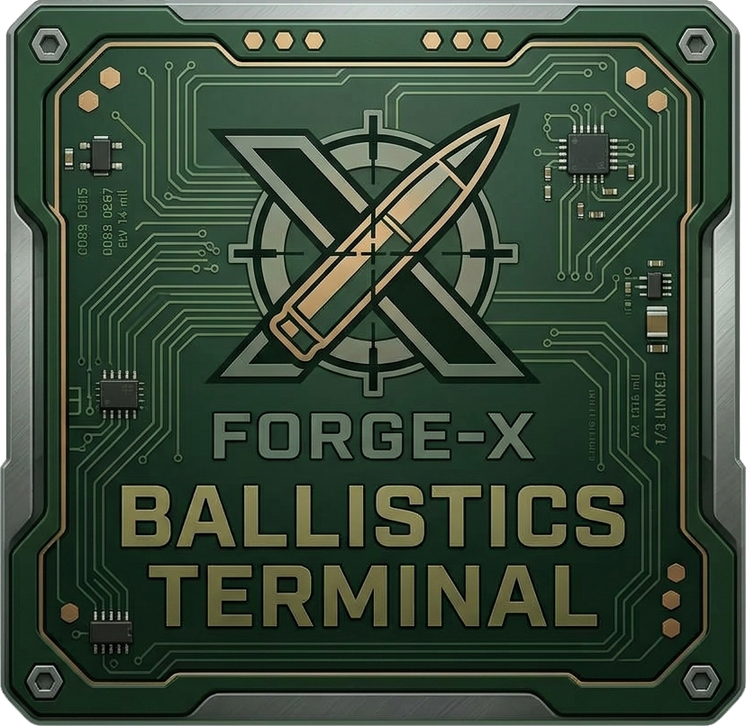

# Forge-X Ballistics Terminal

  

Fire-direction computer for **Arma Reforger** indirect fire — M777 155mm howitzer,
M252 81mm and 2B14 82mm mortars. Type in gun + target grids, get the exact gun
settings back. No guesswork, no tabbed-out browser calculators.

## What it does

- **Fire missions** — enter gun/target grids + altitudes, get charge/ring,
  elevation (mils), azimuth, time of flight, and every alternative option
  ranked best-first.
- **Full firing tables** — transcribed from the in-game manuals: M107 HE +
  AirBurst (CH 1–5), M821/M819/M853A1/M879 (rings 0–4), O-832DU/D-832DU/S-832S,
  including height and wind corrections.
- **Map plotting** — 35 game maps with click-to-place gun/target pins, zoom,
  range rings, and marker↔grid sync both ways.
- **Overlay panels** — pin BALLISTIC CTRL + SHOT DATA over the game while you
  shoot. Draggable, lockable (click-through), translucent, multi-monitor.
- **FDC tablet copy-block** — every solution prints the exact MISSION-screen
  fields (GRID/ALT/WDIR/WSPD/RNDS/ANGLE/SHEAF/AMC/FFE/FZ) to type in-game.
- **Auto-updates** — new versions announce themselves in-app; one click
  downloads and installs.

## Install

1. Download **ForgeX-Ballistics-Setup-1.0.20.exe** from
   [Releases](https://github.com/Dopemodz420/Forge-X-BallisticsTerminal/releases).
2. Run it (installs the VC++ runtime automatically if missing).
3. Launch **Forge-X Ballistics Terminal** from the Start Menu.

Requirements: Windows 10/11 x64.

## License key

The terminal needs a license key to unlock — ask your seller. Keys are bound
to one PC (HWID) on first use. No key, no fire missions.

## Support

Contact your seller for keys, issues, and update questions.
